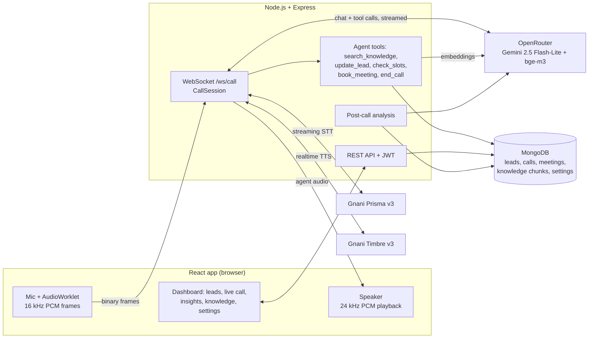

# Voice Sales Agent

An autonomous AI sales agent that talks to leads by voice in the browser, in English, Hindi or Hinglish. It answers product questions from your documents, qualifies the lead, books a demo into the calendar, updates the CRM, and writes a call summary with sentiment and a lead score.

Built on the MERN stack (MongoDB, Express, React, Node.js), with [Gnani Vachana](https://docs.gnani.ai) for speech and [OpenRouter](https://openrouter.ai) for the language model (Google Gemini 2.5 Flash-Lite) and embeddings (BAAI bge-m3).

## What it does

| Requirement | How it is built |
|---|---|
| Real-time voice (STT + TTS) | The browser streams 16 kHz mic audio over a WebSocket. The server relays it to Gnani Prisma v3 streaming STT, sends the transcript to Gemini, and speaks each sentence through Gnani Timbre v3 TTS as soon as it is written. The lead can interrupt (barge-in). |
| Contextual memory | Each lead keeps facts and summaries from earlier calls; they go into the agent's prompt on the next call ("last time you said you'd check with your manager..."). |
| Multilingual | Gnani detects the language per sentence (10 Indian languages); the agent replies in the same language and every Timbre v3 voice speaks all ten. |
| Lead qualification | During the call the agent saves budget, decision maker, need, timeline and interest with an `update_lead` tool; the CRM card updates live on screen. |
| Sentiment analysis | After the call the model scores sentiment (-1 to 1), lead score (0-100) and temperature (hot / warm / cold). |
| RAG knowledge | Upload PDFs or text. They are chunked, embedded with `bge-m3` (multilingual), stored in MongoDB, and searched by cosine similarity through a `search_knowledge` tool. |
| Appointment booking | `check_slots` and `book_meeting` tools book demos in configurable hours; a unique index stops double booking. |
| CRM integration | Leads, pipeline status, calls, transcripts and meetings live in MongoDB and are shown in the dashboard. |
| Summaries and insights | Each call gets a summary, objections and next step. The Insights page shows the pipeline, conversion, sentiment, top objections and languages. |

## Architecture



More detail, including scaling to 1,00,000 users, security and costs: [docs/ARCHITECTURE.md](docs/ARCHITECTURE.md).

## Run it locally

Needs Node.js 22+, a MongoDB server (local or Atlas), a [Gnani API key](https://app.gnani.ai) and an [OpenRouter API key](https://openrouter.ai/keys).

```bash
npm install
cp .env.example .env      # then fill in the keys and a long JWT_SECRET
npm run dev               # http://localhost:4000
```

Log in with `ADMIN_EMAIL` / `ADMIN_PASSWORD` from `.env`. Use Chrome, and headphones if you can (the agent filters its own echo, but headphones make interruptions cleaner).

Production build: `npm run build && npm start` (serves the built React app from Express).

## Demo in five minutes

1. **Knowledge**: upload `samples/flowdesk-brochure.md` (a fictional HR and payroll product).
2. **Leads**: add a lead, for example "Rahul Sharma, Acme Textiles", and press **Call**.
3. **Start call**. The agent greets Rahul. Ask "How much does it cost for 50 employees?" in English or Hindi; it answers from the brochure.
4. Tell it your need, budget and when you want to start; watch the live CRM card fill in.
5. Ask for a demo on Thursday; it offers free slots and books one.
6. Say goodbye. The agent hangs up, and a few seconds later the lead page shows the summary, sentiment, score and memory.
7. Call again: the agent remembers the earlier conversation. Open **Insights** and **Meetings**.

## Project layout

```
server/
  index.js      Express app, WebSocket endpoint, Vite dev middleware
  call.js       One live call: STT -> LLM (tools) -> sentence-by-sentence TTS, barge-in, transcript
  gnani.js      Gnani streaming STT and realtime TTS clients
  llm.js        OpenRouter chat streaming with tool calls, JSON mode, embeddings
  prompt.js     The agent's system prompt (persona, rules, calendar, lead memory)
  tools.js      Tools the agent can call, with input validation
  rag.js        Chunking, embedding and similarity search
  booking.js    Demo slots in India time and race-safe booking
  analysis.js   Post-call summary, sentiment, lead score, memory
  insights.js   Dashboard numbers
  routes.js     REST API
  db.js, auth.js
client/
  public/mic-worklet.js   Mic -> 1024-byte PCM frames on the audio thread
  src/voice.js            Browser side of a call
  src/pages/              Leads, LeadDetail, CallPage, Knowledge, Meetings, Insights, Settings, Login
samples/flowdesk-brochure.md
docs/ARCHITECTURE.md
```

## Known limits

- Browser calls only; phone calls need a SIP or telephony bridge (see the roadmap in the architecture doc).
- Booking is in India time only, with no external calendar sync (meetings have an "Add to Google Calendar" link).
- One admin login; no multi-tenant accounts yet.
- A Gnani streaming session lasts at most 15 minutes, so calls are capped at 15 minutes.
