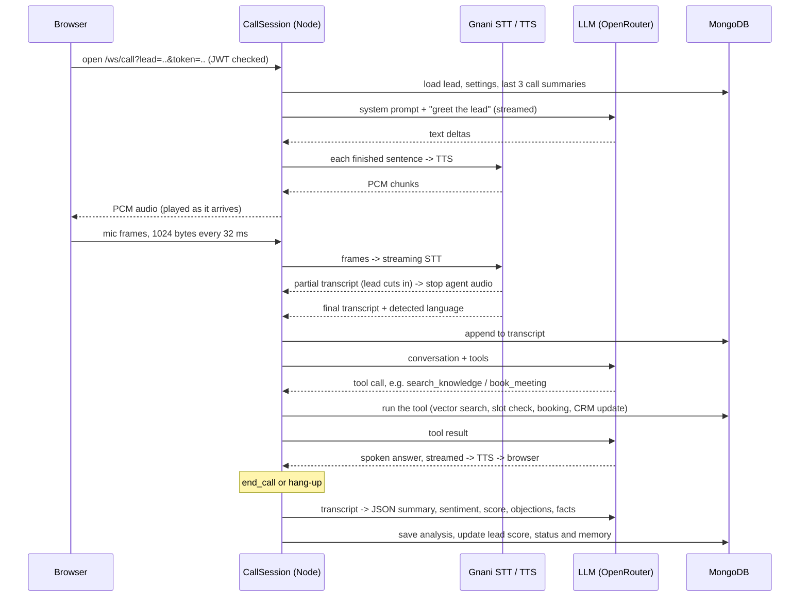

# Architecture, scale, security and cost

## 1. Business problem

Indian SMB sales teams lose most inbound and outbound leads because nobody calls them fast enough, in their language, at the hours they pick up. A human sales development rep (SDR) costs around ₹25,000 to ₹40,000 a month, handles one call at a time, speaks two or three languages, and logs calls into the CRM inconsistently.

The agent calls every lead within minutes, in the lead's language, answers questions from approved documents only, qualifies the lead, books the demo, and leaves a clean CRM record with a summary and score. Human reps spend their time on hot leads and demos.

## 2. Components

| Part | Technology | Job |
|---|---|---|
| Web app | React 19, React Router 7, Vite | Dashboard, live call screen, mic capture and playback |
| API | Node.js 22, Express 5, JWT | Leads (CRM), knowledge, meetings, insights, settings |
| Call server | `ws` WebSocket, one `CallSession` per call | Relays audio, runs the agent loop, streams speech back |
| Speech-to-text | Gnani Prisma v3 streaming (`indic-auto`) | Voice activity detection, partial and final transcripts, language detection |
| Text-to-speech | Gnani Timbre v3 realtime WebSocket | 24 kHz PCM, 34 voices that speak 10 Indian languages |
| Language model | Google Gemini 2.5 Flash-Lite through OpenRouter (`LLM_MODEL`) | Conversation with tool calling; JSON-mode call analysis. Chosen as the cheapest model on OpenRouter with fast tool calling and good Hindi, without paid thinking tokens. |
| Embeddings | `baai/bge-m3` through OpenRouter (`EMBED_MODEL`), 1024 dimensions, multilingual | RAG over uploaded documents |
| Database | MongoDB with Mongoose 9 | Leads, calls with transcripts, meetings, knowledge chunks, settings |

## 3. One call, step by step

Latency per reply, measured locally with Gnani and Gemini 2.5 Flash-Lite: voice activity end (600 ms of silence) + final transcript (about 300 ms) + model (about 1 to 1.4 s to the first words) + first TTS audio (150 to 400 ms on a warm socket). A plain answer starts about 2 s after the lead stops. A knowledge lookup needs a second model round trip, so the agent says a short "One moment, please" at once and the full answer follows about 2 s later.

Speed tricks already in place:
- Speech is sent to TTS sentence by sentence while the model is still writing.
- One TTS socket per call is kept warm and reused.
- Partial transcripts stop the agent's audio as soon as the lead says two non-echo words.
- An echo filter ignores the agent's own voice picked up by laptop mics.

## 4. Data model

- **Lead**: name, company, phone, email, status (`new`, `contacted`, `qualified`, `meeting_booked`, `not_interested`), score, temperature, qualification (budget, authority, need, timeline, interest, notes), memory (facts for the next call).
- **Call**: lead, start and end, end reason, languages, transcript lines, analysis (summary, sentiment, sentiment score, lead score, temperature, objections, next step, key facts).
- **Meeting**: lead, call, start, end, topic, email, status. A partial unique index on `start` for booked meetings stops two calls booking the same slot.
- **KnowledgeChunk**: document id and name, chunk text, embedding.
- **Settings**: agent name, company, pitch, voice, listening language, demo hours, days and slot length. These are editable live, so the agent changes without a deploy.

## 5. Scaling to 1,00,000 users

Sizing assumption: 1,00,000 leads, each called about once a month, three minutes per call. That is 3,00,000 minutes a month. Spread over 22 working days of 9 hours, it averages about 25 calls at the same moment, and planning for 5x peaks gives about 125 to 150 live calls.

| Layer | Now (MVP) | At 1,00,000 users |
|---|---|---|
| Call servers | One Node process | Stateless Node containers behind a load balancer with sticky WebSockets. A call is I/O-bound (resampling happens in the browser), so one small container holds 100+ calls; 3 to 4 containers cover the peak, with autoscaling on open sockets. |
| Outbound campaigns | Calls start from the dashboard | A job queue (BullMQ on Redis) dials leads with per-tenant rate limits, retry rules and legal calling hours. |
| Post-call analysis | Runs right after the call in the same process | Queue workers, so a burst of hang-ups never slows live calls. |
| Database | Single MongoDB | MongoDB Atlas replica set; indexes on `lead`, `status`, `start`; shard calls by tenant when multi-tenant. |
| RAG search | In-memory cosine over all chunks (fine up to tens of thousands) | Atlas Vector Search index on `embedding` (`$vectorSearch`), filtered by tenant. |
| Insights | Computed from the last 1,000 calls on request | Precomputed daily rollups with `$group` pipelines, cached in Redis. |
| Speech and LLM | Free and pay-as-you-go keys | Gnani enterprise concurrency limits; OpenRouter routes across providers, and the model is one env variable, so a fallback model is a config change. |
| Telephony | Browser only | A SIP bridge (for example Exotel, Plivo or Twilio media streams) feeds 8 kHz audio into the same `CallSession`; Gnani STT already supports 8 kHz. |

## 6. Data security and compliance

Already built:
- JWT login for the dashboard and the call socket.
- Secrets live only in `.env`.
- Every tool input from the model is validated and trimmed before it touches the database.
- Model JSON (the call analysis) is bounded and checked.
- Documents are treated as data, and the prompt says to answer only from them.
- The agent says it is an AI at the start of the call.
- Uploads and request sizes are capped.

For production:
- TLS everywhere and Atlas encryption at rest.
- An IP allowlist on the database.
- Role-based users per tenant.
- Phone and email masked in logs.
- Audit logs.
- A retention policy (for example, delete transcripts after 180 days).
- Data stored in India (AWS Mumbai) to meet the Digital Personal Data Protection Act, 2023, with consent capture and delete-on-request.
- For outbound phone calls: a DND/NCPR check, the TRAI-registered 140/160 number series, and calling only between 9 am and 9 pm.

## 7. Infrastructure and deployment

- **MVP:** one VM or container running `npm run build && npm start`, MongoDB Atlas free tier, and HTTPS through a reverse proxy (Caddy or Nginx).
- **Production:**
  - Docker images on AWS ECS or Kubernetes in Mumbai.
  - An Application Load Balancer with WebSocket stickiness.
  - Atlas M30 or higher, and ElastiCache Redis for queues and caches.
  - CloudWatch or Grafana for monitoring call count, time to first audio, STT/TTS/LLM error rates and cost per call.
  - Blue-green deploys: draining a container waits for its live calls to finish.

## 8. Operating cost (estimates)

Gnani does not publish a rate card, so speech uses Sarvam AI's public rates as a stand-in until Gnani's quote is in. OpenRouter prices are read from its model API. Check both before quoting a customer.

| Item | Basis | ₹ per call minute |
|---|---|---|
| Speech-to-text | about ₹30 per audio hour (Sarvam public rate) | about 0.50 |
| Text-to-speech | about ₹15 to ₹30 per 10,000 characters; the agent speaks about half the time, roughly 400 characters per call minute | about 0.6 to 1.2 |
| Gemini 2.5 Flash-Lite (OpenRouter) | $0.10 input and $0.40 output per 1M tokens; about 12,000 input and 400 output tokens a minute | about 0.1 to 0.15 |
| Analysis and embeddings | One JSON call per call; bge-m3 embeddings cost $0.01 per 1M tokens | under 0.05 |
| Servers, database, Redis | about ₹50,000 to ₹1,00,000 a month at 3,00,000 minutes | about 0.2 to 0.35 |
| **Total (browser calls)** | | **about ₹1.5 to ₹2.3** |
| Phone line, if used | Indian telephony providers | add about ₹0.5 to ₹1.5 |

At 3,00,000 minutes a month, that is roughly ₹4.5 to ₹7 lakh a month all-in, against about ₹7 to ₹8 per talk-minute for a human SDR (₹30,000 a month for about 66 hours of talk time).

## 9. Commercial feasibility

- **Pricing:** ₹5 to ₹6 per connected minute, or a monthly plan (for example ₹15,000 for 3,000 minutes), plus an optional fee per booked demo. At ₹1.5 to ₹2.3 cost per minute, that is a 55 to 75 percent gross margin before telephony.
- **Buyers:** Indian SMB SaaS, EdTech, real estate, insurance and lending teams with high lead volume and Hindi or regional-language customers.
- **Why it can win:**
  - Indian-language speech from Gnani.
  - A cheap model with tool calling.
  - The CRM, booking and analytics are already included, so a team can start from one dashboard instead of stitching tools together.

## 10. Roadmap (not built in this MVP)

1. Phone calls through a SIP bridge, plus an outbound campaign queue.
2. Sync to external CRMs (HubSpot, Zoho) and calendars (Google, Cal.com) through webhooks.
3. Multi-tenant accounts and roles.
4. Warm transfer to a human rep on request.
5. An evaluation set of recorded calls, to tune prompts and catch regressions.
